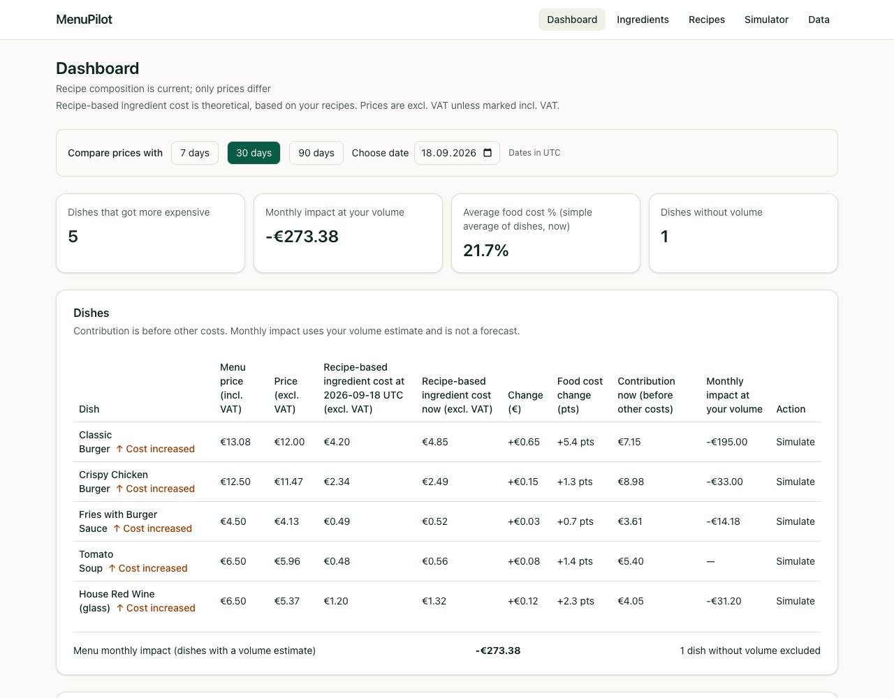
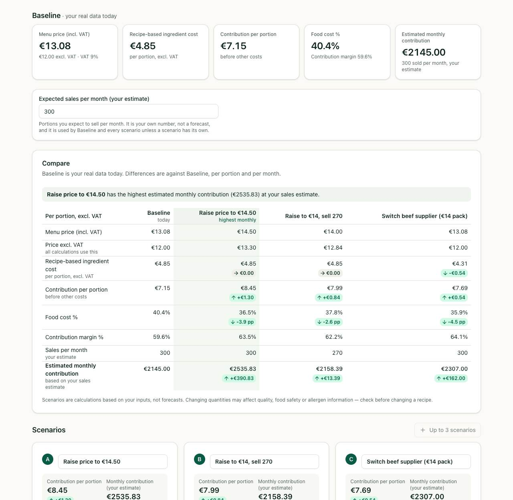
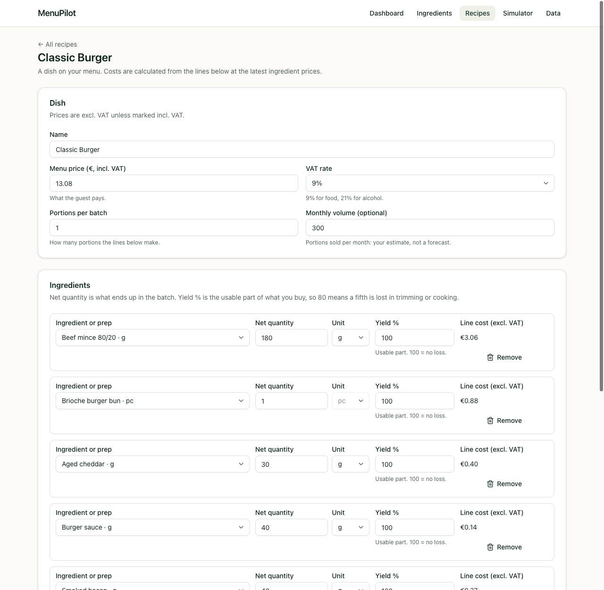
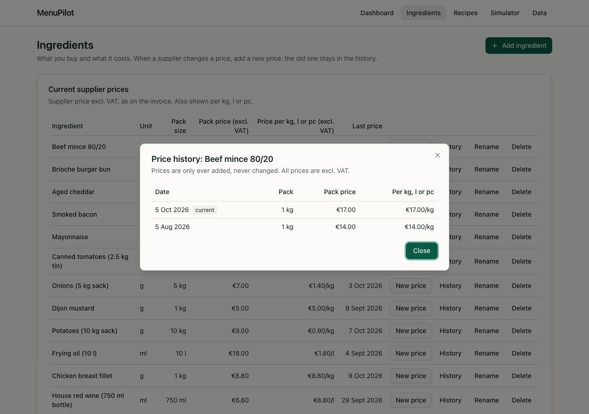
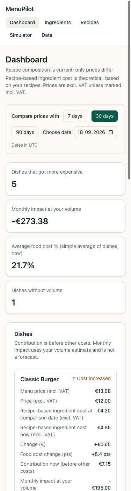

# MenuPilot

**Live demo: <https://gadzhaprod.github.io/menupilot/>** (fictional demo data, runs entirely in your browser)

MenuPilot is a small web app for independent restaurant owners. It turns recipes and supplier prices into a clear answer to one question: *"My supplier raised a price. What does that do to my dishes and to my month, and what should I change?"*



## Problem

Supplier prices keep changing. An owner sees a new invoice but cannot quickly tell:

- which dishes now cost more to make, and by how much;
- how much contribution is lost per month at current sales;
- what happens if the menu price goes up, or a portion gets smaller;
- which of those options is better.

## Solution

MenuPilot keeps ingredients with their price history, builds dish and prep (sub-recipe) costs from them, shows what changed since a chosen date, and lets the owner play out decisions in a **Profit Simulator** without touching real data.

## Key features

- **Dashboard.** Compare costs now against 7 / 30 / 90 days ago, or any date. Per dish: ingredient cost then and now, change in euros and in food-cost points, contribution now, and the monthly impact at the owner's own volume estimate. Preps are listed separately with their cost per kg, l or pc.
- **Profit Simulator.** For one dish, try a new menu price, new ingredient pack prices, other quantities and your own sales estimate. Up to three scenarios (A, B, C) are compared side by side with **Baseline** (today's real data), with differences per portion and per month. Scenarios are saved separately with their own baseline snapshot and never change real prices or recipes.
- **Preps and sub-recipes.** A sauce, dough or stock is a recipe of its own that dishes use. An ingredient price change flows through every level (up to 5). Cycles are rejected; an unknown price makes every parent show "cost unknown" instead of a wrong number.
- **Price history.** Ingredient prices are append-only. The current price is the latest entry and older ones stay visible.
- **VAT handling.** The menu price is entered incl. VAT (9% or 21%); all calculations use the price excl. VAT. Every price on screen is labelled "incl. VAT" or "excl. VAT".
- **Backup.** The *Data* page exports all data as one JSON file, imports it back (atomic: a bad file changes nothing) and resets to the demo data.
- A step-by-step user guide in English, Dutch and Russian is built into the app: **Help**. It opens in the language of the screen (EN/NL); Russian is chosen by hand. The pictures show the light theme, with Dutch screenshots for the Dutch guide.

| Simulator with three scenarios | Recipe with a prep |
|---|---|
|  |  |

| Ingredient price history | On a phone (375 px) |
|---|---|
|  |  |

## Important to know

- **Contribution is not profit.** "Contribution" is the menu price excl. VAT minus the recipe-based ingredient cost. It is *before* labour, rent and all other costs. MenuPilot never calls it profit.
- **Ingredient cost is theoretical.** "Recipe-based ingredient cost" is what the recipe should cost, not what was actually used (waste and over-portioning are not measured).
- **Scenarios are not forecasts.** They are calculations on the numbers you type, including your own monthly sales estimate. MenuPilot does not predict demand.
- **Your data lives in your browser.** There is no server and no account. Clearing browser data, or using private mode, can erase it. Export a backup regularly.
- **Previous versions:** Data and recovery keep up to 10 versions within 1 MiB; restoring creates a new revision. A seven-day Export reminder starts with your own changes. Clearing the browser deletes this history too; only a backup file kept elsewhere protects against that loss.

## How MenuPilot differs

Tools such as Apicbase, meez, MarketMan and Restaurant365 are broad restaurant operations systems (inventory, purchasing, POS and more), built mainly for multi-location businesses. MenuPilot is deliberately much smaller: a fast scenario calculator for a single restaurant. In the public materials I looked at, I did not find an interface that compares a Baseline with scenarios A/B/C for one dish side by side. That is a statement about what I found, not a claim that no such feature exists anywhere. This is not a comparison of quality or price.

## Architecture

```
  Screens (React 19, Tailwind v4, shadcn/ui)       src/ui/pages, layout, dashboard, simulator
        │
  Typed adapter (readonly TS types, BigInt results) src/ui/domain/*.ts
        │
  ┌─────┴───────────────┐
  │ src/calc  (pure)    │  all formulas, BigInt, no I/O, no DOM
  │ src/store (JSDoc JS)│  validation, versioned JSON document, import/export
  └─────────────────────┘
        │
  localStorage  (static app, no backend, deployed to GitHub Pages)
```

- The store is the single source of truth. A command runs outside React's reducers; on success the new document replaces the one on screen, on failure the screen keeps the old document and shows the error.
- Only the document is saved. Calculation results are derived with `useMemo` and never stored.
- Hash routes (`#/`, `#/ingredients`, `#/recipes`, `#/recipe/:id`, `#/simulator/:id`, `#/data`) work on GitHub Pages.
- Planning documents (product spec, architecture, implementation plan) are in [docs/planning](docs/planning/).

## Money and rounding

- Money is stored as **integer euro cents**. No floats are used for money, and user decimals are parsed from strings, never with `parseFloat`.
- Inside `src/calc` costs are **integer micro-euros** (1 € = 1 000 000 µ€) in `BigInt`.
- The only rounding operation is `roundDiv`: division rounded **half away from zero**, the same for positive and negative numbers. It is applied only at the points listed in the rounding contract (section 6 of [03_ARCHITECTURE.md](docs/planning/03_ARCHITECTURE.md)), for example once per recipe line and when a value is shown in cents.
- Scenario differences are computed from the displayed (already rounded) values, so the screen always adds up.

## Testing

```sh
npm test          # test:core (node:test) + test:ui (Vitest, Testing Library, jsdom)
npm run check     # typecheck + all tests + production build
npm run test:e2e  # Playwright on Chromium against production preview under /menupilot/
```

`npm run check` intentionally skips Playwright to keep the fast local check quick. `npm run test:e2e:install` installs Chromium for local runs. Playwright runs Chromium at 1280×800 and 375×812 against the production build and blocks external network requests. CI runs these browser tests on pull requests and branches, and on `main` before uploading the GitHub Pages deployment artifact. Failed CI runs retain the HTML report, screenshots, and traces as an artifact.

Playwright uses `retries: 0`; a failure is reported immediately with its trace and screenshot so flaky behavior stays visible. The fast check currently covers 145 core tests and 341 UI tests. The E2E suite has 20 Chromium tests across desktop and 375 px projects. Keep the manual browser check for changes to screens: inspect desktop and 375 px layouts, keyboard and focus behavior in dialogs, and field validation messages.

Calculation changes are written test-first. Unit and UI tests use in-memory storage; e2e starts each test with clean browser storage and exercises the real local production preview without external services.

## Run locally

```sh
npm ci            # install the exact locked dependencies
npm run dev       # development server, http://localhost:5173/
npm run build     # production build into dist/ (base path /menupilot/)
npm run preview   # serve dist/ at http://localhost:4173/menupilot/
npm run typecheck # tsc --noEmit
npm run check     # typecheck + tests + build
npm run test:e2e:install # install Playwright Chromium
npm run test:e2e  # production build + Chromium end-to-end tests; no retries
```

Money input accepts a decimal comma or point and rejects thousands separators.

## Requirements

- **Node.js** `^20.19.0`, `^22.13.0` or `>=24` (the range Vite 8 and the test tools support; CI uses Node 24).
- **Browsers** (set by Tailwind CSS v4): Safari 16.4+, Chrome 111+, Firefox 128+.

## Deployment

Every push to `main` runs typecheck, tests and build in GitHub Actions (`.github/workflows/pages.yml`) and publishes `dist/` to GitHub Pages at `/menupilot/`. Other branches and pull requests run the same checks in `ci.yml`.

## Authorship

**MenuPilot is original work by GadzhaProd.** The product idea, scope and every stage were defined and approved by the product owner; the code was written for this project by AI coding agents working under that direction. The calculation core (`src/calc`), the data store and validation (`src/store`), the Profit Simulator, the Dashboard, the built-in Help guide and all screens were built from scratch for MenuPilot.

The plan, architecture decisions and agent rules are public: [docs/planning](docs/planning/) and [AGENTS.md](AGENTS.md).

**Built with open-source tools.** Like any modern web app, MenuPilot runs on open-source libraries — React, Vite, Tailwind CSS, Radix UI, lucide-react and others, pinned to exact versions. Their licences require a notice, so they are listed in [THIRD_PARTY_NOTICES.md](THIRD_PARTY_NOTICES.md), together with:

- [shadcn/ui](https://ui.shadcn.com) base components (MIT) in `src/components/ui/`;
- two small MIT-licensed components from [21st.dev](https://21st.dev) (Badge Delta, Alert with Action Buttons), adapted; licence texts in `third_party/21st/`.

**Inspiration.** The costing approach (base units, yield %, costs excl. VAT) was inspired by [kitchen-costing-for-claude-code](https://github.com/Enterprise-DNA-OS/kitchen-costing-for-claude-code) (MIT, Enterprise DNA). No code was copied from it.

## Demo data

The demo restaurant, its dishes, suppliers and prices are fictional.

## License

MenuPilot is released under the [MIT License](LICENSE) © 2026 GadzhaProd. Third-party code keeps its own licenses; see [THIRD_PARTY_NOTICES.md](THIRD_PARTY_NOTICES.md).
